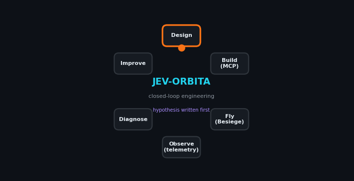
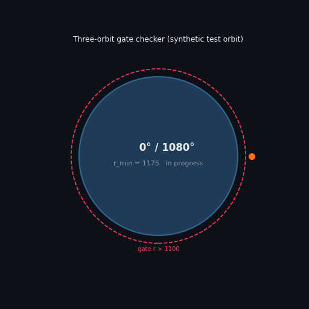
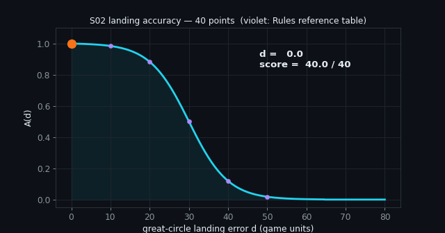
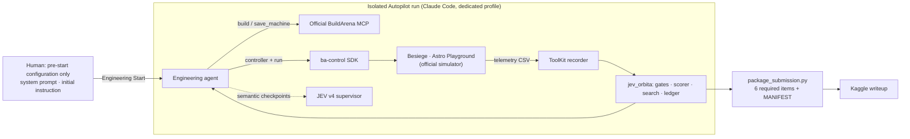
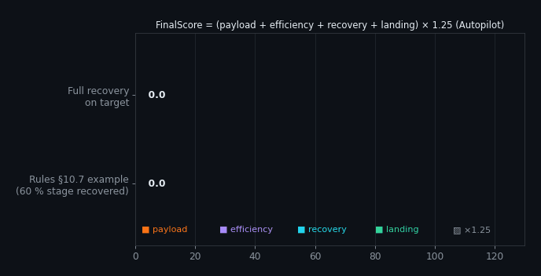
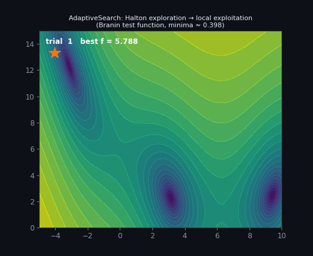

<div align="center">

# 🚀 JEV-ORBITA

### An autonomous, evidence-first engineering system for the BuildArena S02 *Deliver · Separate · Return* mission

[](https://www.kaggle.com/competitions/build-arena-human-ai-engineering-challenge)
[](#compliance-by-design)
[](#verification)
[](pyproject.toml)
[](LICENSE)



</div>

---

JEV-ORBITA is the **engineering system** behind our entry to the
[BuildArena S02 Human–AI Engineering Challenge](https://www.kaggle.com/competitions/build-arena-human-ai-engineering-challenge)
(ICML 2026 BuildArena benchmark, Westlake University). In Season 02 an AI agent must design a
launch vehicle in **Besiege**, build it through the official **BuildArena MCP**, write its own
flight controller, put an unpowered payload through **three continuous orbits**, and bring the
launch hardware **home intact and on target** — without a single human engineering decision
after *Engineering Start*.

JEV-ORBITA turns that loop into a disciplined scientific process: every design change is a
written hypothesis, every claim is measured on official telemetry, every candidate is repeated,
and every number is produced by deterministic, unit-tested code rather than by a language model.

> **Rule-aware by construction.** S02 forbids prebuilt mission machines and ready-made
> controllers, and forbids sharing final machines across teams before the deadline. This
> repository therefore contains the *engineering system* only. The agent-built machine,
> controller, trajectory and transcript are published here after the submission deadline
> (2026-11-14 AOE).

## Highlights

| | |
|---|---|
| 🧪 **Scientific method built in** | Hypothesis → design → control → ≥3 repeats → official metric → decision, logged in `experiments/LOG.md` and a machine-readable CSV. Negative results are first-class. |
| 📐 **Rules-faithful scorer** | Implements every published S02 term (payload, fuel efficiency, mass-weighted recovery, landing accuracy, ×1.25 Autopilot) and reproduces the Rules' reference table and worked example exactly. |
| 🛰️ **Gate checkers from telemetry** | Continuous angular orbit progress on one plane, strict `r > 1100` radius gate, great-circle landing error — straight from Rules §7.3, §7.4, §10.6. |
| 🔒 **Isolated, auditable agent run** | One command starts a clean Claude Code session with only the official MCP, the official BuildArena 2.0 checkout and these helpers; full stream transcript captured for `chat_transcript.md`. |
| 🧭 **JEV v4 semantic supervision** | The JEV-Orchestrator is consulted only at semantic checkpoints (initial routing, new failure mode, architecture change, completion gate); exact maths stays deterministic. |
| 📦 **Submission packager** | Assembles and verifies the six required items, hashes them, and scans for credentials before anything leaves the machine. |

## The S02 mission in one picture

<div align="center">


</div>

*Left:* the gate checker counting continuous angular progress on a **synthetic** two-body test
orbit (an illustration of the tool, not a flight result). *Right:* the official landing-accuracy
kernel `A(d) = [1 − tanh((d − 30)/10)] / [1 + tanh 3]`, with the Rules' reference values in violet.
Seventy percent of the score is earned on the way **home**: recovery (30) and landing accuracy (40).

## Architecture



| Component | Path | Role |
|---|---|---|
| Scorer and gates | `src/jev_orbita/core.py` | Published S02 score terms, qualification gates, mass-weighted recovery/landing |
| Geometry | `src/jev_orbita/geometry.py` | Great-circle landing error, continuous angular progress, strict radius gate |
| Search | `AdaptiveSearch` in `core.py` | Deterministic Halton exploration → bounded local exploitation (Optuna also allowed) |
| Ledger | `ExperimentLedger` in `core.py` | Append-only JSONL with content-hash experiment IDs |
| JEV adapter | `JevRouter` in `core.py` | Safe call to the local JEV v4 router; rejects non-live provenance |
| Preflight | `scripts/preflight.py` | Verifies the Rules §5.2 environment and that no prebuilt mission artefact exists |
| Engineering Start | `scripts/engineering_start.ps1` | Starts / administratively resumes the isolated Autopilot run |
| Transcript | `scripts/transcript_to_md.py` | Stream-JSON → `chat_transcript.md` (instruction, resumes, agent reasoning) |
| Packager | `scripts/package_submission.py` | Checks and hashes `machine.bsg`, both histories, `trajectory.csv`, `control/`, transcript |
| Prompts | `prompts/` | Agent system prompt and the complete initial Autopilot instruction |

## Scoring, exactly as the Rules define it

<div align="center"></div>

```
PerformanceScore = Payload(6..15) + Efficiency(6..15) + Recovery(0..30) + Landing(0..40)
FinalScore       = PerformanceScore × 1.25   (Autopilot)
Gate             = 3 continuous unpowered revolutions, every payload point r > 1100
```

The relative terms need the best value in the scoring pool; when it is unknown, JEV-ORBITA
returns `null` instead of inventing a number.

## Search that learns from every flight

<div align="center"></div>

`AdaptiveSearch` spreads the first trials with a low-discrepancy Halton sequence and then
contracts around the best feasible point. On the Branin test function it reaches
f = 0.407 in 60 trials (global minimum 0.398) — the same bounded, reproducible behaviour the
agent uses for controller gains and staging thresholds, with every trial repeated to control
simulator variance.

## Verification

```text
$ python -m unittest discover -s tests -v
Ran 14 tests ... OK
```

| ID | Hypothesis | Result | Decision |
|---|---|---|---|
| E000 | Scorer reproduces Rules §10.6 table and §10.7 example | A(0…50) = 1.000, 0.984, 0.883, 0.501, 0.119, 0.018 (all within ±0.0006); example → Recovery 18.000, Landing 24.000 exactly | ✅ accepted |
| E001 | Local PC matches the official §5.2 environment | Harness, JEV v4, uv ready; game installation pending | ⏳ pending |

Full log: [`experiments/LOG.md`](experiments/LOG.md) · CSV: [`experiments/experiments.csv`](experiments/experiments.csv).

## Quick start

Prerequisites (Rules §5.2): Windows 10/11, Steam, **Besiege** (build 25434581) with **The
Splintered Sea** and **The Broken Beyond**, the Workshop **BuildArena ToolKit** (3795335349) and the
official [BuildArena 2.0](https://github.com/build-arena/BuildArena-2.0) checkout (v2.1.2) with
its one-command setup passed.

```powershell
git clone https://github.com/Agnuxo1/JEV-ORBITA-BuildArena-S02
cd JEV-ORBITA-BuildArena-S02
.\scripts\env.ps1; $env:PYTHONPATH = "$PWD\src"
python -m unittest discover -s tests -v       # deterministic checks
python .\scripts\preflight.py                 # official environment + compliance gate
.\scripts\engineering_start.ps1 -Login        # one-time auth of the isolated agent profile
.\scripts\engineering_start.ps1               # Engineering Start (Autopilot)
python .\scripts\package_submission.py runs\<stamp>
```

Regenerate the figures: `PYTHONPATH=src python docs/make_figures.py`.

## Compliance by design

- **No prebuilt solution:** the preflight refuses to start if any `machine.bsg` or
  `trajectory.csv` exists in the harness; the agent starts from an empty workspace.
- **No human engineering after Engineering Start:** the only permitted message is the
  administrative *"Continue the previous work."*, logged with its timestamp.
- **Isolated context:** a dedicated Claude Code profile excludes personal memories, hooks and
  plugins; hooks are disabled and only the official MCP server is loaded.
- **Banned hardware** (parachutes, automation and surface blocks) and payload exclusions are
  spelled out in the agent prompt and enforced by the official block registry.
- **No credentials in submissions:** the packager scans every text artefact.

## Status and roadmap

**28 October check:** the account is entered on Kaggle, but Besiege is absent
from the configured Steam libraries and the official setup report is missing.
No valid mission, telemetry, game score or final submission is claimed.
The three planned mission experiments remain blocked on that environment;
the 14 framework/scorer tests are not substitutes for game experiments.

The authenticated Kaggle API gives the exact cutoff **15 November 00:00 UTC
(01:00 Madrid)**. The overview separately says 14 November AoE. These differ;
use the earlier API cutoff until the organiser reconciles them. Do not convert
the AoE wording to 01:00 CET.

- [x] Rules checked; exact API cutoff recorded above, AoE discrepancy retained
- [x] Scorer validated against the Rules' reference values
- [x] Isolated Autopilot launcher, transcript converter and packager
- [ ] Official setup and reproduction of the official `rocket_orbit_return` example (second scorer check)
- [ ] Engineering Start → agent-built machine, controller and final mission
- [ ] Kaggle writeup, mission video, post-deadline release of the full submission package

## Known limitations

The official setup and mission reproduction remain blocking checks. This scorer
has been validated against the printed Rules; its agreement with the current
official release still needs to be demonstrated. The evidence-level scorer takes per-machine integrity and stable time as
measured inputs rather than recomputing them from raw block telemetry; and full engineering
runs need a licensed Windows installation of Besiege, so they are reproducible only in the
official environment.

## Credits

- **BuildArena 2.0** and the S02 challenge — AI for Scientific Simulation and Discovery Lab,
  Westlake University (sponsored by Uniforce AI). Official tools are used unmodified and are
  not redistributed here (their licence: CC BY-NC 4.0).
- **Besiege** — Spiderling Studios.
- **JEV-Orchestrator / TartanIMU Cognitive Stack** — Francisco Angulo de Lafuente.
- Engineering agent: Anthropic Claude (Claude Code CLI).

## Author

**Francisco Angulo de Lafuente** ([@Agnuxo1](https://github.com/Agnuxo1)) — with AI engineering agents.

## License

MIT — see [LICENSE](LICENSE). BuildArena, Besiege and their assets remain under their own licences.
